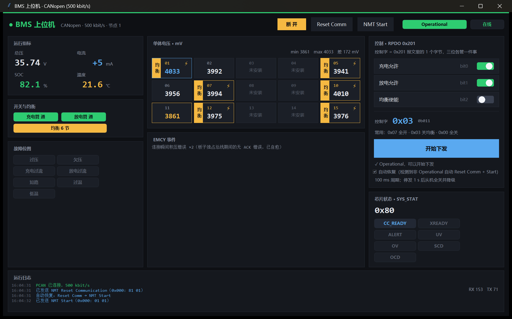
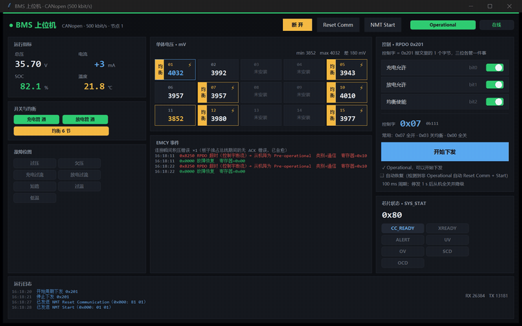

# 9 串锂电池管理系统（BMS）

基于 **STM32F103 + TI BQ76940** 的 9 串锂电池管理系统，FreeRTOS 多任务架构。本分支实现 **CANopen 从机**；另有 `modbus-rtu`（Modbus RTU 从机）与 `debug`（调试版）分支，三者共用同一套采样 / 保护 / 均衡 / SOC 代码，区别只在通信层与调试输出。

- **功能**：AFE 采样、保护判据（OV/UV/OCD/SCD/OT/UT）、被动均衡、SOC 估算、CANopen 从机
- **上位机**：`tools/canopen_gui.py`（python-can + tkinter），TPDO 解码、SDO 轮询、EMCY 列表、控制下发
- **演示**：`docs/demo_canopen.mp4`（63 秒：连接 → 均衡 → 停发降级 → Reset Comm 恢复）
- **编译**：Keil MDK 5 打开 `MDK-ARM/tem.uvprojx`，Rebuild 后 J-Link 下载
- **问题排查记录**：[docs/问题排查记录.md](docs/问题排查记录.md)

---

# BMS 从机 CANopen 接口说明

9 串锂电池 BMS（STM32F103 + bq76940）的 CANopen 从机接口。协议栈为 CANopenNode V4，对象字典由 CANopenEditor 生成（`Middleware/CANopen/OD/`，源文件 `project.xdd`）。

分工：单体电压走 SDO 由主站轮询，其余运行数据走两个 TPDO 周期上报，充放电/均衡控制走一个 RPDO。以下全部参数已在 500 kbps 总线上板验收。





- 演示视频 63 秒：`docs/demo_canopen.mp4`（连接 → 均衡 6 节 → 停发降级 → Reset Comm 恢复，全流程）
- 配套上位机 `tools/canopen_gui.py`（python-can + tkinter）：TPDO 解码、单体电压格阵、SDO 轮询、EMCY 事件列表、控制字下发、NMT Start / Reset Comm 一键恢复。运行 `py -3 tools/canopen_gui.py`。

## 1. 总线参数

| 项 | 值 |
|---|---|
| 节点 ID | 0x01 |
| 波特率 | 500 kbps |
| NMT 状态 | 上电自动进入 Operational，无需主站启动 |
| 心跳 | 0x701，500 ms，数据字节 = NMT 状态（05 = Operational，7F = Pre-operational） |
| EMCY | 0x081，抑制时间 1 ms |
| SDO 服务器 | 0x601（请求）/ 0x581（应答），超时 1000 ms |

## 2. 报文总览

| COB-ID | 方向 | 周期 | 长度 | 内容 |
|---|---|---|---|---|
| 0x181 | 从机→主站 | 250 ms | 8 | 总压、节数、电芯位图、电流、SYS_STAT |
| 0x281 | 从机→主站 | 250 ms | 8 | SOC、温度、故障位图、均衡位图、MOS 状态 |
| 0x701 | 从机→主站 | 500 ms | 1 | 心跳 |
| 0x081 | 从机→主站 | 事件 | 8 | EMCY |
| 0x201 | 主站→从机 | 建议 ≤1000 ms | **1** | 控制字（充/放/均衡） |
| 0x601/0x581 | 双向 | 按需 | 8 | SDO |

## 3. 对象字典（厂商区 0x2000-0x200B）

| 索引 | 名称 | 类型 | 单位 | 访问 | 说明 |
|---|---|---|---|---|---|
| 0x2000 | 单体电压 | ARRAY 15×U16 | mV | 只读 | 仅 SDO；未安装电芯的通道固定为 0 |
| 0x2001 | 总压 | U16 | mV | 只读 | TPDO1 |
| 0x2002 | 电芯数 | U8 | — | 只读 | 实际安装数（本板 9） |
| 0x2003 | 电芯位图 | U16 | — | 只读 | bit n = 第 n+1 节在位，本板 0x4E73 |
| 0x2004 | 电流 | S16 | mA | 只读 | 充电为正 |
| 0x2005 | SOC | U16 | 0.1 % | 只读 | 0xFFFF = 尚未完成 OCV 校准 |
| 0x2006 | 温度 | S16 | 0.1 ℃ | 只读 | 外部 NTC |
| 0x2007 | 故障位图 | U8 | — | 只读 | 位定义见下 |
| 0x2008 | 均衡位图 | U16 | — | 只读 | 当前实际在均衡的电芯 |
| 0x2009 | MOS 状态 | U8 | — | 只读 | bit0 充电管 / bit1 放电管，1 = 导通 |
| 0x200A | SYS_STAT | U8 | — | 只读 | bq76940 硬件状态寄存器原值 |
| 0x200B | 控制字 | U8 | — | RPDO | bit0 充电允许 / bit1 放电允许 / bit2 均衡使能 |

### 0x2007 故障位图

| bit | 掩码 | 含义 |
|---|---|---|
| 0 | 0x01 | 过压 OV |
| 1 | 0x02 | 欠压 UV |
| 2 | 0x04 | 充电过流 COC |
| 3 | 0x08 | 放电过流 DOC |
| 4 | 0x10 | 短路 SC |
| 5 | 0x20 | 过温 OT |
| 6 | 0x40 | 低温 UT |

### 0x200A（bq76940 SYS_STAT 原值）

| bit | 掩码 | 含义 |
|---|---|---|
| 7 | 0x80 | CC_READY（新库仑计读数可用） |
| 5 | 0x20 | DEVICE_XREADY（芯片自检未就绪） |
| 4 | 0x10 | ALERT |
| 3 | 0x08 | UV |
| 2 | 0x04 | OV |
| 1 | 0x02 | SCD |
| 0 | 0x01 | OCD |

## 4. TPDO 帧布局（小端）

**0x181（TPDO1）**

| 字节 | 内容 |
|---|---|
| 0-1 | 总压，mV |
| 2 | 电芯数 |
| 3-4 | 电芯位图 |
| 5-6 | 电流，mA（S16） |
| 7 | SYS_STAT 原值 |

**0x281（TPDO2）**

| 字节 | 内容 |
|---|---|
| 0-1 | SOC，0.1 % |
| 2-3 | 温度，0.1 ℃ |
| 4 | 故障位图 |
| 5-6 | 均衡位图 |
| 7 | MOS 状态 |

## 5. RPDO 控制字（0x201）

**必须发 DLC=1**。映射长度是 1 字节，发 8 字节虽然数据仍然生效，但会触发"PDO 长度超出"EMCY（0x8220）。

| 值 | 行为 |
|---|---|
| 0x07 | 充电 + 放电 + 均衡 全部允许（正常运行） |
| 0x03 | 充放允许、均衡关闭（测电流/SOC 前用） |
| 0x00 | 全部关闭 |

三点须知：

1. 控制字只是**请求**，MOS 最终由"请求 AND 无故障"裁决——故障挂着时主站发 0x07 也开不了管。
2. 均衡有静置门：`|电流| ≤ 50 mA` 才真正开均衡，充放电过程中 bal_mask 保持 0 是设计使然。
3. **从机从未收到过 RPDO 时（timer == 0），三个使能保持本地默认（全开）**，BMS 可独立于主站工作。控制字的真正用途是"关"和"接管"，不是"开"。

## 6. SDO 访问示例

读第 1 节电压（0x2000 子索引 1）：

```
请求 0x601: 40 00 20 01 00 00 00 00
应答 0x581: 4B 00 20 01 9D 0F 00 00     → 0x0F9D = 3997 mV
```

应答首字节表示数据长度：1 字节 = 4F，2 字节 = 4B，4 字节 = 43。多字节一律小端。

读错误寄存器 0x1001：`40 01 10 00 00 00 00 00`。

单体电压轮询建议 1 Hz（15 节 × 1 Hz ≈ 3% 总线负载），台架调试可到 250 ms。

## 7. EMCY

EMCY 帧格式（CANopenNode 在 CiA 301 基础上，第 4 字节固定放错误类编号）：

```
[0-1] 错误码（大端）  [2] 错误寄存器  [3] 错误类编号  [4-7] 附加信息（小端）
```

| 错误码 | 错误类 | 触发条件 | 后果 |
|---|---|---|---|
| 0x8250 | 0x17 | RPDO 超时（1000 ms 无控制字） | 0x1001 通信位置 1 → **自动降 Pre-operational** |
| 0x8220 | 0x04 | 收到的 RPDO 长度超出映射 | 仅提示，不降级 |
| 0x3300 | 0x40 | 电压类故障（OV/UV），附加信息 = 0x2007 位图 | 0x1001 厂商位置 1 |
| 0x2300 | 0x41 | 电流类故障（COC/DOC/SC） | 同上 |
| 0x4000 | 0x42 | 温度类故障（OT/UT） | 同上 |
| 0x0000 | — | 对应错误恢复 | 错误类编号仍在第 4 字节 |

故障消失时只发一帧 0x0000 恢复报文；EMCY 是事件通知，**判断当前是否仍有故障请读 0x2007 或 0x1001**。

## 8. NMT 与掉线恢复

RPDO 超时（1000 ms，0x1400 子索引 5）后的固定行为链：

```
控制字断流 1 s → EMCY 0x8250 → 0x1001 通信位置 1 → 节点自动降 Pre-operational
（心跳变 7F，TPDO 停发；Pre-op 下 RPDO 不再被处理，仅靠恢复发送救不回来）
```

主站恢复流程（顺序固定）：

```
① 发 NMT Start：COB-ID 0x000，DLC 2，数据 01 01
② 确认心跳变回 05
③ 再开始周期发送 0x201 控制字
```

## 9. 其他通信区对象

| 索引 | 说明 |
|---|---|
| 0x1000 | 设备类型，0（占位，用于生成 OD_CNT_NMT） |
| 0x1001 | 错误寄存器：bit4 通信错误、bit7 厂商定义（任一 0x40~0x42 类故障挂着即置位），SDO 可读 |
| 0x1003 | 预定义错误历史，10 条，SDO 可回读 |
| 0x1011 | 恢复默认参数（存储模块未启用，实际无效） |
| 0x1014 | EMCY COB-ID = 0x081 |
| 0x1015 | EMCY 抑制时间 = 1 ms |
| 0x1016 | 心跳消费者，8 项默认全 0（不监视主站；RPDO 超时已覆盖该需求） |
| 0x1017 | 心跳生产周期 = 500 ms |
| 0x1018 | 身份对象，值全 0 |
| 0x1200 | SDO 服务器 COB-ID：0x601 / 0x581 |
