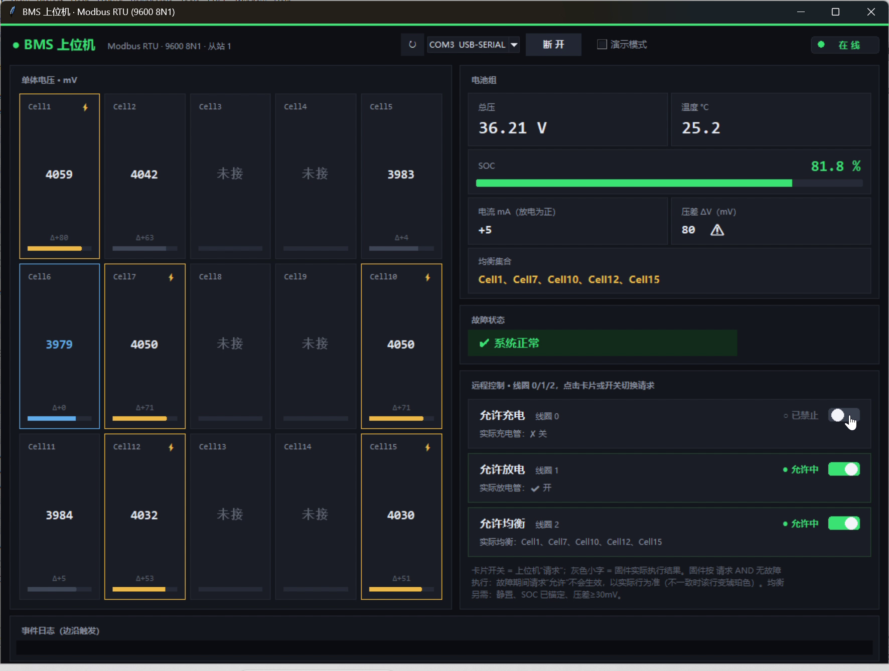
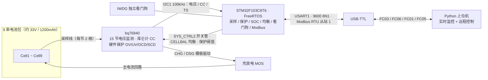
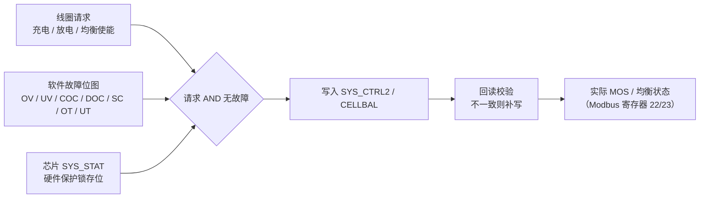

# 九串电池管理系统（STM32F103 + FreeRTOS + bq76940 + Modbus RTU）

毕业找嵌入式工作，想做个能完整拿得出手的项目，就做了这个九串 BMS。芯片是最常见的 STM32F103C8T6 + TI 的 bq76940 模拟前端，电池是 9 节 18650（约 33V）。固件从零写的，FreeRTOS 裸工程（没用 CubeMX 的 CMSIS 封装，任务全是静态创建），通信走 Modbus RTU，另外配了个 Python 上位机，方便演示也方便自己调。

先看效果（都是真机录的）：

- 演示视频 57 秒：`docs/demo.mp4`
- 上位机截图（当时正在均衡 Cell1、Cell7、Cell11）：

## 系统框图

硬件与数据流：

保护与远程控制的决策链（线圈只是"请求"，保护永远优先）：

## 它能做什么

每 250ms 采一轮 9 节电压、电流（bq76940 的库仑计）、温度，然后：

- **保护**：过压、欠压、充放电过流、短路、过温、低温。软件判定做了两道保险——连续几拍都超限才报警（防单次毛刺）、带回差（防在阈值附近抖）。bq76940 自己还有一套硬件保护（OV/UV/OCD/SCD，直接断管），两边并行。
- **MOS 控制**：充放电管每周期会真的去读回 `SYS_CTRL2`，和期望状态比一下，不一致就补写。这样不管是硬件保护把位清了、还是 I2C 偶发写失败，都不用复位就能自己恢复。这个是改过三版才成的，最早那版拿"上次的记忆"当"芯片的现状"，芯片自己关了管它都不知道。
- **SOC**：开机用 OCV 开路电压锚定一次初值，之后安时积分。静置时在线估计电流零漂。没做掉电保存（没有 EEPROM，也不想让电池包天天写 Flash），靠开机重新锚定，够用。
- **被动均衡**：每轮贪心挑一批互不相邻的电芯一起均衡（bq76940 相邻节不能同时开）。均衡的远程开关也做成了 Modbus 线圈。
- **可靠性**：独立看门狗 + 各任务心跳由 MonitorTask 统一仲裁；I2C 连续失败 5 次就自动 DeInit/Init 重来；I2C 驱动层有互斥量，但调度器启动之前不加锁（那时候只有 main 一个执行流，加了反而多余）。

## 远程控制的一个原则

上位机通过线圈（功能码 05）可以关/开充电、放电、均衡。但线圈只是"请求"，固件里真正执行的是 **请求 AND 无故障**——故障期间你写一百次"开"，管子也不会开。实际状态单独放在寄存器 23，上位机界面上请求和实际是分开展示的，两边对不上会变黄提醒。

## Modbus 寄存器（功能码 03/06，地址从 0 起）

| 地址 | 含义 | 说明 |
|---|---|---|
| 0 | 电芯数 | 9 |
| 1 | 电芯位图 | bit i = 第 i+1 节接了没有 |
| 2~16 | 单节电压 | mV，没接的为 0 |
| 17 | 总压 | mV |
| 18 | 电流 | mA，int16 补码，放电为正 |
| 19 | SOC | ×10，0xFFFF 表示还没锚定 |
| 20 | 温度 | ×10 ℃ |
| 21 | 故障位图 | 0x01过压 0x02欠压 0x04充电过流 0x08放电过流 0x10短路 0x20过温 0x40低温 |
| 22 | 均衡位图 | bit i = 第 i+1 节正在均衡 |
| 23 | MOS 实际状态 | bit0 充电管 bit1 放电管，1=开 |

线圈（01/05）：0 充电使能、1 放电使能、2 均衡使能，默认全开。读回来的是请求值，实际结果看寄存器 22/23。

## 上位机

`tools/host_gui.py`，Python + tkinter。这个是 AI 辅助生成的（我不写 Python），但寄存器表、线圈语义、故障位定义是我设计的，我对它的正确性负责：CRC 用 Modbus 文档的标准向量核过，读数和 Modbus Poll 对过，最后在板上跑通了完整闭环。串口选 COM3 点连接就能用，没硬件可以勾"演示模式"看界面。

## 踩过的坑

做这个项目花时间最多的其实是排错，记几个印象深的：

1. **均衡一开就报短路。** 静置 4mA 的板子，均衡一开就报 20 多安的短路，查了几天。最后定位到是 1.9mA 的均衡电流从 VSS 回流，被库仑计引脚的 100Ω 滤波电阻捡到了（22424 计数 × 8.44µV ÷ 100Ω ≈ 1.89mA，和均衡电流对得上）。硬件改不了，就在软件上用窗口法：均衡跑 10 秒停 1 秒，停的这 1 秒读一拍干净的电流，再做电流类判断和 SOC 积分。
2. **板子每隔几秒自动复位。** 看门狗的锅：HAL 的 `IWDG_PRESCALER_64` 宏的值其实是 4（寄存器编码，分频是 4×2^编码），我图省事直接填了 64，实际超时被算成 0.19 秒，任务永远喂不上。后来喂狗的位置也改过——心跳自增要放在延时前面，不然第一口饭要等一个周期，上来就被咬。
3. **Modbus 联调一直报 Insufficient bytes received。** 固件的发送链路查了个遍都没问题，最后发现是上位机的校验位设成了 Even——从站是 8N1，一边 10 位一边 11 位，两边对"字节在哪结束"都谈不拢，字节全被丢了。现在排查通信问题我第一眼看校验位。
4. **末端两节电压在大电流下偏高约 150mV。** 开关均衡做对照实验证明和均衡无关，是采样点跟主电流路径共用、接触电阻上的压降。硬件问题软件治不了，如实标注，充电时心里有数就行。

## 已知限制

- 均衡电流只有约 1.9mA，100mV 级的压差理论上要 6~12 天才能拉平——这是硬件能力，不是策略问题；急着均衡得改板加外部均衡管。
- 无 EEPROM，SOC 不掉电保存（取舍见上）。
- CANopen 分支刚开了个头，FreeRTOS 裁剪完了（Flash 26KB / RAM 6KB），等确认板上 CAN 收发器接 PA11/PA12 再继续。

## 分支

- `modbus-rtu`：当前看的这个，Modbus 完整版，所有 printf 都删干净了（串口只有一个写者）
- `debug`：开发版，带全套诊断打印
- `canopen`：CANopen 移植中

